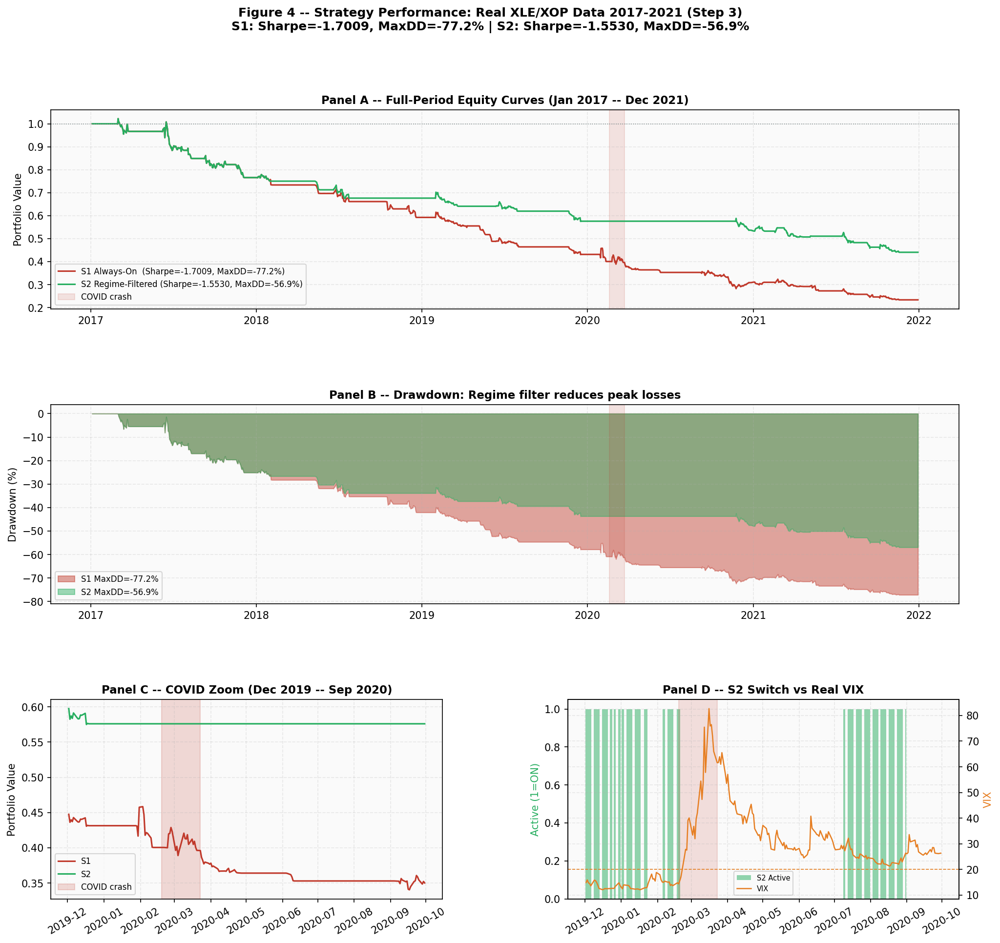

# The Regime-Aware Pairs Trader

Does a pairs trading strategy do better if it stops trading when the market is in a high-volatility regime?

Written by Joseph Bidias for the Capstone Review course (MScFE 692) in the Master of Science in Financial Engineering at WorldQuant University, May 2026. It was submitted for the course as Group Work Project 2 under Group 14744.

## Short answer

Neither strategy made money over 2017 to 2021. The version that sits out high-volatility periods lost less, mostly because it traded less and was out of the market during the COVID-19 crash. The two ETFs I chose also failed the cointegration test, which goes a long way toward explaining why the basic strategy lost money.

## What I tested

- **Pair:** XLE (Energy Select Sector SPDR) and XOP (SPDR S&P Oil and Gas Exploration and Production ETF)
- **Period:** January 2017 to December 2021, 1,257 trading days
- **Data:** adjusted daily closing prices and the VIX from Yahoo Finance, downloaded with `yfinance`
- **Strategy 1 (always on):** trade the spread when its 60-day z-score passes 2.0, exit below 0.5, stop out above 4.0
- **Strategy 2 (regime filtered):** the same rules, but only when a Markov-Switching model fitted to S&P 500 returns puts at least 60% probability on the low-volatility regime
- **Costs:** 10 basis points per trade

## Results

| Measure | Strategy 1 | Strategy 2 |
|---|---|---|
| Cumulative return | -76.6% | -55.9% |
| Annualized return | -25.3% | -15.2% |
| Annualized volatility | 14.9% | 9.8% |
| Sharpe ratio | -1.701 | -1.553 |
| Maximum drawdown | -77.2% | -56.9% |
| Number of trades | 25 | 19 |
| Time in the market | 45.3% | 29.7% |

Other findings:

- **Cointegration.** The ADF test on the spread residuals gives a statistic of -2.32 and a p-value of 0.165. The Engle-Granger test gives a p-value of 0.360. Neither rejects the null of no cointegration, and the same is true in each of the four sub-periods. The estimated half-life of the spread is 107 trading days, which is slow for a trading strategy.
- **Regimes.** The Markov-Switching AR(1) model classifies about 26% of days as high volatility. During the COVID-19 crash (February 19 to March 23, 2020), Strategy 2 was out of the market on 91.7% of days.
- **Non-linearity.** The BDS test rejects independence in the raw spread in 9 of 9 settings, and in 5 of 9 after AR(1) filtering.
- **Value-at-Risk.** A 99% VaR backtest shows 13 exceptions for each strategy, a Kupiec p-value of 0.90, and a Basel green zone.




## Limitations

- The pair is not cointegrated over this sample, so this is a test of a regime filter on a weak pair. It is not evidence that the filter would help a sound pairs trade.
- The hedge ratio is estimated once on the full sample, so the backtest uses information that would not have been available in real time.
- In two of the four sub-periods Strategy 2 did not trade at all. Its Sharpe ratio of zero there reflects inactivity.
- The section on regulation (Basel III, the Volcker Rule, liquidity rules) is a stylized model. The 25% reduction in dealer capacity and the return-on-equity inputs are assumptions chosen for illustration. They are not estimated from data.
- There is no out-of-sample test.

## Run it

```bash
pip install -r requirements.txt
jupyter notebook regime_aware_pairs_trader.ipynb
```

The notebook was written for Python 3.12 in Google Colab. It needs an internet connection to download prices and it saves its charts to a `gwp2_outputs/` folder. Yahoo Finance sometimes revises adjusted prices, so a fresh run can differ slightly from the saved outputs.

## Files

| Path | Contents |
|---|---|
| `regime_aware_pairs_trader.ipynb` | The full analysis with saved outputs |
| `report/regime_aware_pairs_trader_report.pdf` | The written report |
| `figures/` | The charts produced by the notebook |
| `requirements.txt` | Python packages used |
