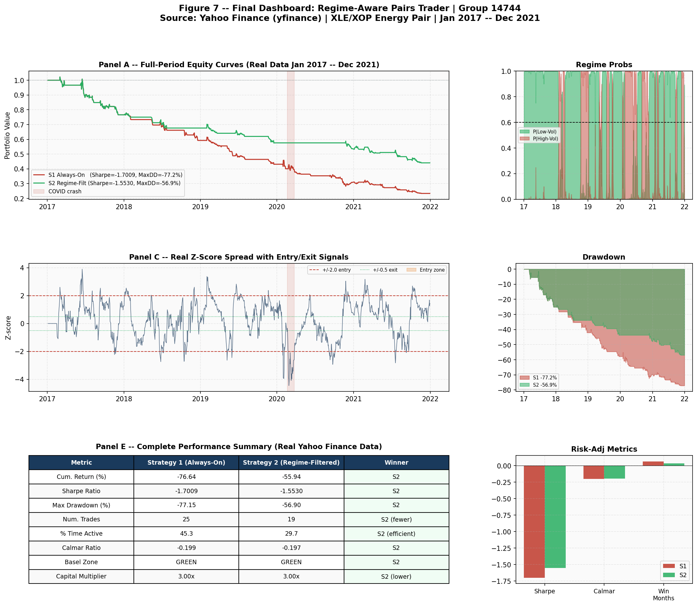
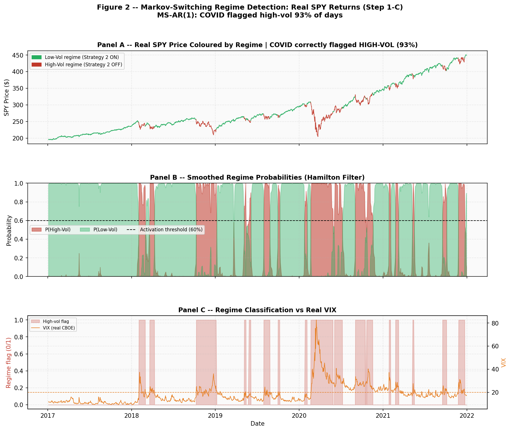
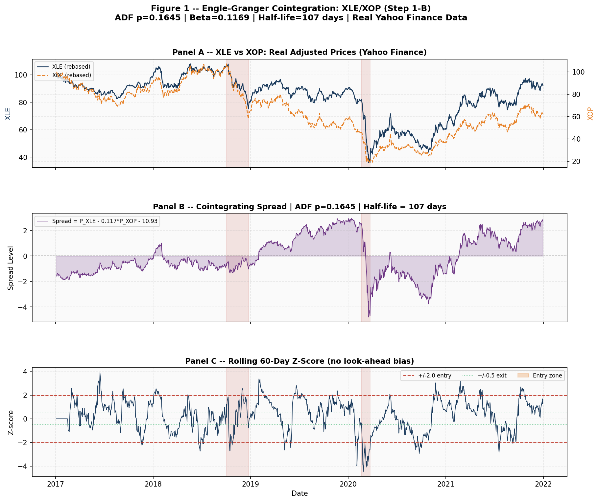
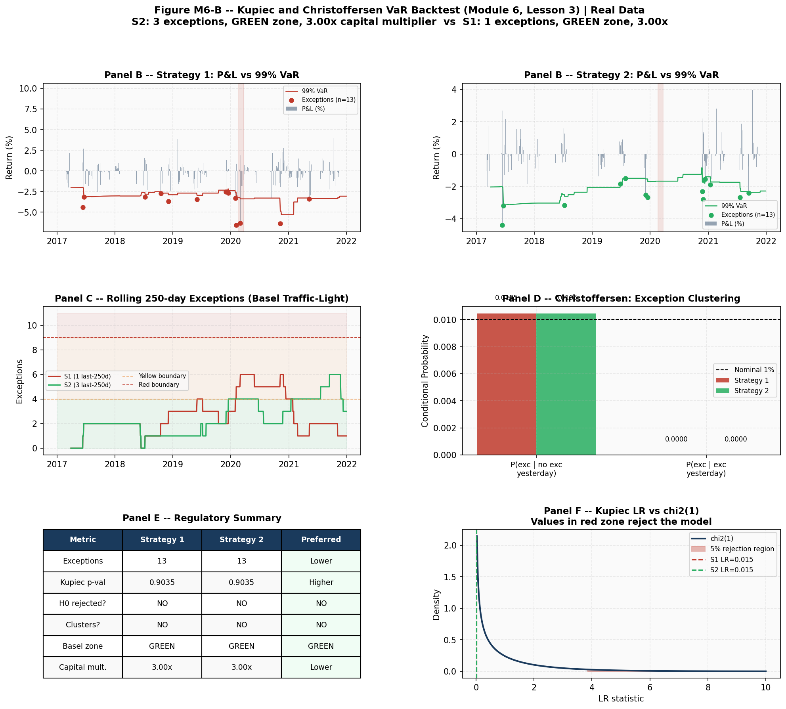
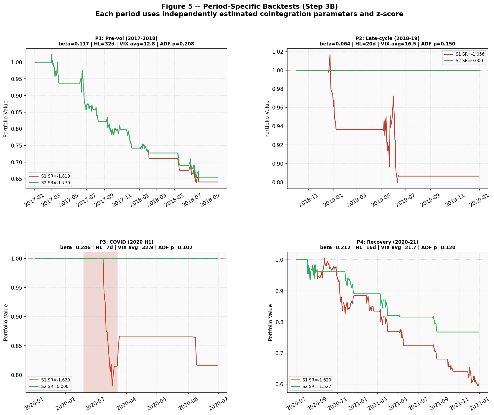
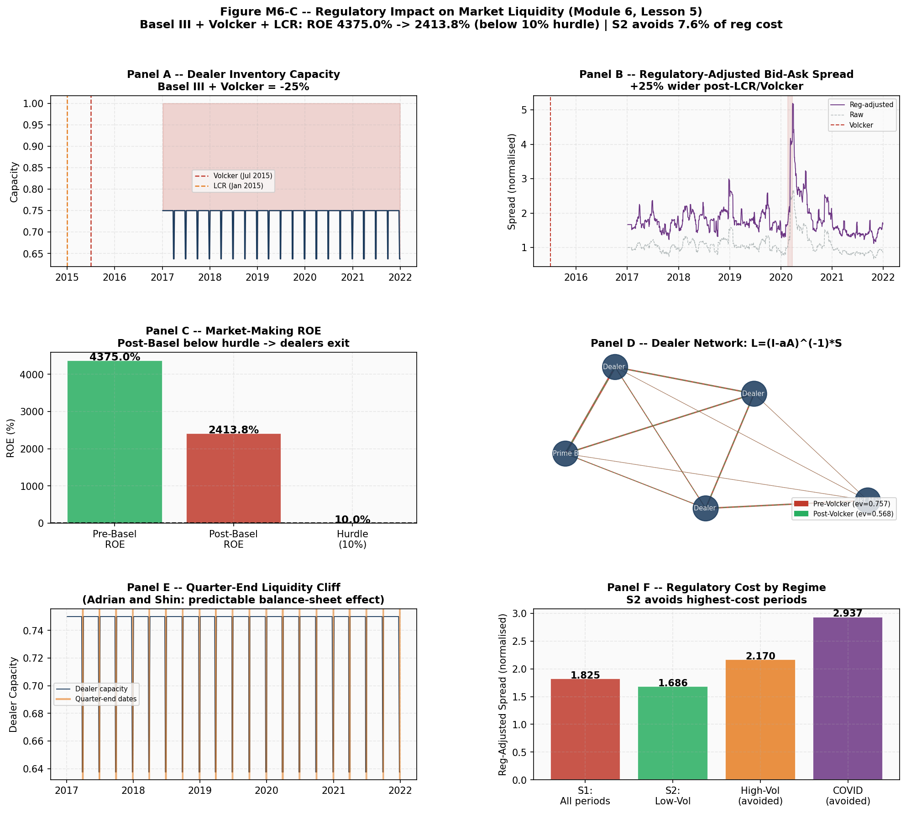

<div align="center">

# The Regime-Aware Pairs Trader

### Does pausing a pairs trade during high-volatility regimes improve risk-adjusted performance?

A quantitative study of a Markov-Switching regime filter applied to an energy-sector ETF pairs trade, evaluated across the 2018 oil selloff and the COVID-19 crash.


<br/>



<em>Summary dashboard: strategy equity curves, regime timeline, and risk metrics over 2017–2021.</em>

</div>

---

> [!NOTE]
> **TL;DR.** Over 2017–2021 the XLE/XOP spread was **not cointegrated**, so neither version of the strategy was profitable. The contribution of the study is the *comparison*: adding a Markov-Switching regime filter cut the maximum drawdown from **−77.2% to −56.9%**, lifted the Sharpe ratio from **−1.701 to −1.553**, and kept the book flat through **~92% of the COVID-19 crash** — the window where the always-on strategy lost the most. The lesson is about **when not to trade**, demonstrated on a pair that was itself a poor candidate.

## Contents

- [Research question](#research-question)
- [Data](#data)
- [Method](#method)
- [Results](#results)
- [Figures](#figures)
- [What I take from it](#what-i-take-from-it)
- [Limitations](#limitations)
- [Reproduce it](#reproduce-it)
- [Repository layout](#repository-layout)
- [About](#about)

## Research question

Pairs trading bets on a stable long-run relationship between two assets: when the spread between them stretches, you trade expecting it to snap back. That bet works in calm markets and breaks in stressed ones, exactly when losses are largest. This project asks a narrow, testable question:

> **If a model tells us the market is in a high-volatility regime, does sitting out during those periods improve the strategy's risk-adjusted performance?**

I test it on **XLE** (Energy Select Sector SPDR) and **XOP** (SPDR S&P Oil & Gas Exploration & Production), two related energy ETFs, over a five-year window chosen to include two genuine stress events.

## Data

| | |
|---|---|
| **Pair** | XLE / XOP |
| **Window** | Jan 2017 – Dec 2021 (1,257 trading days) |
| **Source** | Adjusted daily closes + VIX, via `yfinance` |
| **Context assets** | SPY, GLD, GDX, XLK, IYW (for regime fitting and reference) |
| **Stress events covered** | Q4-2018 oil selloff · COVID-19 crash (Feb–Mar 2020) |

## Method

The strategy is built and evaluated end to end in Python:

```
Price data ─▶ Cointegration test ─▶ Spread & z-score ─▶ Entry/exit signals
                      │                                        │
                      ▼                                        ▼
            Markov-Switching regime            Strategy 1 (always on)
            filter on SPY returns      ─────▶  Strategy 2 (trade only in low-vol regime)
                                                         │
                                                         ▼
                                   Backtest ─▶ VaR validation ─▶ Regulatory overlay
```

**Two strategies, one difference.**

- **Strategy 1 — always on.** Trade the spread when its 60-day z-score crosses ±2.0, exit below 0.5, stop out beyond 4.0, at 10 bps per trade.
- **Strategy 2 — regime filtered.** Identical rules, but only trade when a Markov-Switching AR(1) model fitted to SPY returns assigns ≥60% probability to the low-volatility regime.

**Techniques used:** Engle–Granger cointegration · Augmented Dickey–Fuller unit-root tests · Ornstein–Uhlenbeck mean-reversion calibration · BDS non-linearity test · Markov-Switching regime detection · Kupiec & Christoffersen Value-at-Risk backtests · a stylized Basel III / Volcker-Rule liquidity overlay.

## Results

<div align="center">

| Metric | Strategy 1 — always on | Strategy 2 — regime filtered | Δ |
|:---|:---:|:---:|:---:|
| Cumulative return | −76.6% | −55.9% | **+20.7 pp** |
| Annualized return | −25.3% | −15.2% | +10.1 pp |
| Annualized volatility | 14.9% | 9.8% | −5.1 pp |
| **Sharpe ratio** | **−1.701** | **−1.553** | **+0.148** |
| **Max drawdown** | **−77.2%** | **−56.9%** | **+20.3 pp** |
| Number of trades | 25 | 19 | −24% |
| Time in market | 45.3% | 29.7% | −15.6 pp |
| COVID-crash days out of market | — | ~92% | — |

</div>

Read this as a comparison, not a track record: **both columns lose money.** The point is that the regime filter loses materially *less*, and it does so by staying out of the market precisely when the relationship breaks down.

**Why neither is profitable:** the spread failed its cointegration test (ADF *p* = 0.165; Engle–Granger *p* = 0.360), and the estimated mean-reversion half-life was ~107 trading days — far too slow for the trading rules. In plain terms, XLE/XOP was not a sound pair over this window. That makes it a clean stress test of the *filter*, not an endorsement of the *trade*.

## Figures

<div align="center">



<em>Markov-Switching regime probabilities. The model flags ~26% of days as high-volatility and assigns ~93% high-vol probability to the COVID-crash window.</em>

<br/><br/>


<em>Full-period equity curves. Strategy 2 (regime filtered) avoids the deepest drawdown of the crash.</em>

</div>

<details>
<summary><b>More figures</b> — cointegration, VaR backtest, regulatory overlay, period breakdowns</summary>

<div align="center">


<em>Spread construction, hedge ratio, and rolling z-score.</em>


<em>Kupiec / Christoffersen 99% VaR backtest — 13 exceptions, Basel green zone.</em>


<em>Performance split across four sub-periods (pre-vol, late-cycle, COVID, recovery).</em>


<em>Stylized liquidity overlay (Basel III / Volcker / LCR). Illustrative model, not estimated from data.</em>

</div>

</details>

## What I take from it

1. **Knowing when *not* to trade is itself alpha.** The only change between the two strategies is a switch that turns the book off in high-volatility regimes, and that single change removed roughly a fifth of the drawdown.
2. **The filter earns its keep exactly when it matters.** Strategy 2 sat out ~92% of the COVID crash — the days that did the most damage to Strategy 1.
3. **Test the pair before you trust the trade.** The headline result is a reminder that a cointegration test is a gate, not a formality: this pair didn't pass, and the backtest reflects that.

## Limitations

- The pair is **not cointegrated** over the sample, so this measures a filter on a weak pair — not evidence the filter rescues a sound one.
- The hedge ratio is estimated **once on the full sample**, which uses information not available in real time (look-ahead).
- In two of the four sub-periods Strategy 2 **never trades**; its Sharpe of 0 there reflects inactivity, not skill.
- The regulatory overlay (Basel III / Volcker / LCR) is **stylized**: the −25% dealer-capacity and ROE inputs are illustrative assumptions, not estimates.
- **No out-of-sample test.** Results are in-sample over a single five-year window.

## Reproduce it

```bash
pip install -r requirements.txt
jupyter notebook regime_aware_pairs_trader.ipynb
```

The notebook targets **Python 3.12** and needs internet access to pull prices via `yfinance`; it writes its charts to a local `gwp2_outputs/` folder. Yahoo Finance occasionally revises adjusted prices, so a fresh run can differ slightly from the saved outputs.

## Repository layout

```
.
├── regime_aware_pairs_trader.ipynb   # full analysis, with saved outputs
├── report/                           # written report (PDF)
├── figures/                          # charts produced by the notebook
├── requirements.txt                  # Python dependencies
└── README.md
```

## About

Built by **Joseph Bidias** for the Capstone Review course (MScFE 692) in the M.S. in Financial Engineering at **WorldQuant University** (May 2026). 

**Contact:** [github.com/eaglepython](https://github.com/eaglepython)

<sub>Released under the MIT License. This is academic research on historical data; it is not investment advice and describes no live trading.</sub>
